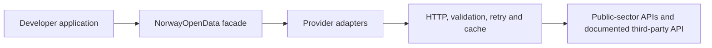

# Norway Open Data SDK

[](https://github.com/iamkm1/Norway-Open-Data/actions/workflows/ci.yml)


[](LICENSE)

One typed TypeScript interface for Norwegian public data.

Norway Open Data SDK provides a consistent, runtime-validated client for official Norwegian APIs
from Brønnøysundregistrene, SSB PxWeb and SSB Klass, FHI, Kartverket/Geonorge, Entur, MET Norway,
Data.norge, Norges Bank, Stortinget, Statens vegvesen, NVE, BarentsWatch, Fiskeridirektoratet,
Miljødirektoratet and NIBIO. It also wraps the documented third-party public electricity API from
Hva koster strømmen?.

- 15 public-sector organizations through 19 official API integrations, plus 1 third-party derived API
- 22 service namespaces
- 118 supported namespace methods in the 0.8.0 surface
- Runtime-validated responses
- Cross-provider profiles that answer one question from several agencies
- Auto-paginating async iterators for list endpoints
- Live AIS position streaming as a plain `AsyncIterable`, with cancellation
- Reusable OAuth2 client-credentials support with single-flight token refresh
- ESM, CommonJS and TypeScript support
- Runs on Node.js, Deno, Bun and edge runtimes from one web-standard build
- Deterministic offline tests plus representative opt-in live contract probes
- Enforced statement, branch, function and line coverage gates

Requests go directly from your Node.js application to the source API. The SDK has no hosted
backend, database, account system or scraping layer.

## Installation

Runs on Node.js 22+, Deno, Bun and edge runtimes such as Cloudflare Workers. TypeScript
declarations are included. See [Runtime support](#runtime-support) for what a host runtime must
provide.

Version `0.8.0` is the current release. Install it with:

```bash
npm install norway-open-data-sdk
```

Contributors can also build and test a local tarball:

```bash
git clone https://github.com/iamkm1/Norway-Open-Data.git
cd Norway-Open-Data

corepack pnpm install
corepack pnpm build
corepack pnpm pack
```

Install the generated tarball from another project:

```bash
npm install /path/to/Norway-Open-Data/norway-open-data-sdk-0.8.0.tgz
```

## Quick start

```ts
import { NorwayOpenData, type Company, type NorwegianAddress } from "norway-open-data-sdk";

const norway = new NorwayOpenData({
  applicationName: "my-application",
  contactEmail: "developer@example.no",
});

const company = await norway.companies.get("923609016"); // OpenDataResponse<Company>
console.log(company.data.name);

const addresses = await norway.addresses.search({
  query: "Haraldsgata 100, Haugesund",
  limit: 1,
});
console.log(addresses.data.items[0]); // NorwegianAddress

const profile = await norway.profiles.company("923609016");
console.log(profile.data.location);
```

Result types follow each provider's own domain language rather than one shared prefix: companies
return `Company`, Kartverket lookups return `NorwegianAddress`, and every entity type is exported
from the package root, so editor auto-import finds the exact name.

Anonymous methods work without configuration. Entur and NVDB require `applicationName`; MET
requires `applicationName` and `contactEmail`; NVE HydAPI requires the caller's own API key.

## Supported providers

| Source                  | Namespace             | Capabilities                                                   | Access                         |
| ----------------------- | --------------------- | -------------------------------------------------------------- | ------------------------------ |
| Brønnøysundregistrene   | `companies`           | Organizations, search and sub-entities                         | Anonymous                      |
| Statistics Norway / SSB | `statistics`, `klass` | PxWeb statistics; Klass classifications, codes and mappings    | Anonymous                      |
| FHI                     | `health`              | Health-register statistics with preserved suppression flags    | Anonymous                      |
| Kartverket              | `addresses`, `places` | Addresses, place names and nearby search                       | Anonymous                      |
| Geonorge / Kartverket   | `geodata`             | Geospatial dataset/service catalogue and typed discovery       | Anonymous; experimental        |
| Miljødirektoratet       | `environment`         | Selected Naturbase protected, NiN and intervention-free layers | Anonymous; experimental        |
| NIBIO                   | `land`                | Generalized AR50 land-resource classification                  | Anonymous; experimental        |
| Entur                   | `transport`           | Autocomplete, departures and journeys                          | Identification required        |
| MET Norway              | `weather`             | Locationforecast data and current entry                        | Identification + contact email |
| Data.norge              | `catalog`             | Datasets, data services and publishers                         | Anonymous                      |
| Norges Bank             | `currency`            | Exchange rates, policy rate and NOWA                           | Anonymous                      |
| Stortinget              | `parliament`          | Representatives, parties, cases, votes, questions and meetings | Anonymous                      |
| Statens vegvesen / NVDB | `roads`               | Road metadata, objects and network segments                    | Identification required        |
| NVE                     | `energy`, `hazards`   | Energy data, warnings and hydrology                            | Anonymous; API key for HydAPI  |
| BarentsWatch AIS        | `ais`                 | Vessel positions, tracks, area search and live AIS streaming   | OAuth2 AIS-client              |
| BarentsWatch            | `marine`              | Wave and sea-current point forecasts                           | OAuth2 API-client              |
| Fiskeridirektoratet     | `fisheries`           | Fishing-vessel register and public aquaculture register        | Anonymous                      |
| Hva koster strømmen?    | `electricity`         | Hourly spot prices for all five bidding zones                  | Anonymous third-party API      |

`profiles` composes several providers into one answer: `company` combines Brønnøysundregistrene
with a Kartverket address match, `address` combines Kartverket, MET Norway, NVE and NVDB,
`municipality` combines SSB, FHI, Brønnøysundregistrene and NVE, and `vessel` combines BarentsWatch
AIS with the Fiskeridirektoratet vessel register, MET Norway and Kartverket.
`natureAtLocation` combines Naturbase, NIBIO and Kartverket with per-component provenance and
partial-failure handling.

BarentsWatch has two distinct service contracts in the SDK, and they need **separate credentials**.
BarentsWatch issues two kinds of self-registered client, and neither one's secret works for the
other service:

- `ais` → an **AIS-client**, whose tokens carry the `ais` scope, configured under
  `credentials["barentswatch-ais"]`.
- `marine` → an **API-client**, whose tokens carry the `api` scope, configured under
  `credentials.barentswatch`.

Register each at [BarentsWatch MyPage](https://www.barentswatch.no/minside/).

Fiskeridirektoratet likewise has two independent registers behind one namespace. Both are open and
need no credentials, but they are separate services with separate contracts and paging models, so
they keep separate provider descriptors (`fiskeridir-vessels` and `fiskeridir-aqua`) and separate
record types. A fishing vessel and an aquaculture site are not forced into a shared model.

SSB has two distinct service contracts in the SDK:

- `statistics` → statistical values, table metadata and JSON-stat datasets from PxWeb.
- `klass` → official classifications, versions, codes, code changes and correspondence mappings.

They belong to one public-sector organization, but use separate provider descriptors because their
endpoints, limits, response formats and cache policies differ.

Hva koster strømmen? is an independent third-party service, not a government or official data
provider. Its documentation says the API derives EUR electricity prices from ENTSO-E and converts
them to NOK using the latest Norges Bank exchange rate.

See the [complete capability matrix](docs/capabilities.md) for every namespace, method, access
requirement and known limitation.

## MCP server

Looking for AI-client integration? See
[Norway Open Data MCP](https://github.com/iamkm1/Norway-Open-Data-MCP), a local stdio MCP server
built on this SDK.

```bash
npx -y norway-open-data-mcp
```

The MCP server exposes curated, read-only tools for AI clients while this SDK continues to provide
the underlying Norwegian public-data integrations, validation, retries, caching and typed responses.

They are separate packages in separate repositories, and the dependency runs one way:
`norway-open-data-mcp` depends on `norway-open-data-sdk`, never the reverse. If you are writing
TypeScript or JavaScript, install this SDK and call it directly — the MCP server is not required and
adds nothing to a normal application. Install it only when you want an AI client to reach this data
through the Model Context Protocol.

## Norway Open Data ecosystem

- **Norway Open Data SDK** — typed TypeScript access to Norwegian public APIs.
- [**Norway Open Data MCP**](https://github.com/iamkm1/Norway-Open-Data-MCP) — curated MCP tools for
  AI clients, built on top of this SDK.

## Common examples

The following examples use the configured `norway` client from the quick start.

### Company lookup

```ts
const company = await norway.companies.get("923609016");
console.log(company.data.name);
```

### Catalogue search

```ts
const results = await norway.catalog.search({
  query: "public transport",
  type: ["dataset"],
  size: 5,
});
console.log(results.data.items);
```

### Geospatial catalogue and bounded vector data

The v0.8.0 geospatial namespaces are experimental and anonymous:

```ts
const metadata = await norway.geodata.searchDatasets({
  query: "verneområder",
  limit: 5,
});

const protectedAreas = await norway.environment.searchProtectedAreas({
  boundingBox: { south: 61.45, west: 8.25, north: 61.55, east: 8.45 },
  limit: 100,
  pageSize: 50,
  maxPages: 3,
});

const land = await norway.land.getLandResourcesAt({
  latitude: 61.494,
  longitude: 8.349,
  limit: 25,
});

console.log(metadata.data.items);
console.log(protectedAreas.data.features);
console.log(protectedAreas.data.pagination.truncated);
console.log(land.data.features);
```

Caller points and boxes are WGS84; GeoJSON coordinates are `[longitude, latitude]`. Naturbase and
NIBIO request server-side WGS84 conversion and retain their advertised `sourceCrs`. Unsupported CRS
metadata is rejected rather than guessed, and there is no client-side reprojection engine. Check
`pagination.truncated` before treating a feature result as complete.

`geodata` discovers catalogue metadata, including WFS, WMS, OGC API Features, ArcGIS REST and
download links, but never follows those links. Arbitrary upstream URLs, WMS image rendering,
restricted Geovekst data and nationwide unbounded downloads are outside the SDK.

### SSB Klass classifications and historical codes

Klass is SSB's official system for classifications and codelists. The curated `klass` namespace
keeps it separate from statistical table values:

```ts
import { klassClassificationIds } from "norway-open-data-sdk";

const browse = await norway.klass.listClassifications({
  language: "en",
  page: 0,
  pageSize: 10,
});
console.log(browse.data.items);

// Classification 6 is Standard Industrial Classification; version 3218 is SIC 2025.
const industries = await norway.klass.listCodes({
  versionId: 3218,
  language: "en",
  page: 0,
  pageSize: 20,
});

// Klass supports code patterns, not server-side code-name search.
const occupations = await norway.klass.searchCodes({
  classificationId: klassClassificationIds.occupations, // 7
  codePattern: "25*",
  date: "2026-01-01",
  language: "en",
  pageSize: 10,
});

const oslo = await norway.klass.getCode({
  classificationId: klassClassificationIds.municipalities, // 131
  code: "0301",
  date: "2026-01-01",
  language: "en",
});
```

Classification IDs are stable exported constants. Version IDs identify dated snapshots: discover
available versions with `listVersions()` instead of assuming that a documented version remains
current. `getCode()` also accepts `{ versionId, code }` when an exact snapshot is required. The
documented and tested classifications include municipalities `131`, counties `104`, industry `6`,
occupations `7`, education/NUS `36`, and country codes `91`, `100` and `552`.

Historical administrative resolution follows official code-change edges and returns every branch:

```ts
const historical = await norway.klass.resolveMunicipalityCode({
  code: "0101",
  sourceDate: "2019-01-01",
  targetDate: "2020-01-01",
  language: "en",
});

console.log(historical.data.status); // "replaced"
console.log(historical.data.matches); // [{ code: "3001", name: "Halden", ... }]
console.log(historical.data.predecessors, historical.data.successors);
console.log(historical.data.changes); // dated official graph edges supporting the result
console.log(historical.data.warnings);
```

`unchanged`, `renamed`, `replaced`, `merged`, `split`, `ambiguous`, `not_found` and
`context_required` are explicit outcomes. A one-to-many result is never silently reduced to one
successor. A missing mapping is inconclusive, and administrative correspondence does not prove
that statistics are comparable across boundaries or years.

Fixed correspondence tables expose metadata and an SDK-bounded page:

```ts
const table = await norway.klass.getCorrespondenceTable({
  correspondenceTableId: 2774, // Municipalities 2026 → Municipalities 2024
  language: "en",
  page: 0,
  pageSize: 20,
});
console.log(table.data.sourceVersionName, table.data.targetVersionName, table.data.items);
```

Klass only pages classification browsing/search upstream. Versions, codes, changes and
correspondence maps arrive as complete provider payloads and are paged locally; those results say
`pagination.upstreamPaged === false`. Page sizes are capped at 100. Norwegian Bokmål (`nb`),
Norwegian Nynorsk (`nn`) and English (`en`) are supported where the selected resource publishes a
translation. All results carry SSB Klass source attribution; optional in-process caching uses a
24-hour provider default.

### Cross-provider company profile

```ts
const profile = await norway.profiles.company("923609016");
console.log(profile.data.location);
```

### Cross-provider address profile

One call answers a location from four providers at once:

```ts
const place = await norway.profiles.address("Haraldsgata 100, Haugesund");

console.log(place.data.address.municipalityName); // Kartverket
console.log(place.data.weather?.temperature); // MET Norway
console.log(place.data.hazards); // Exact administrative-area matches from NVE
console.log(place.data.hazardMatches); // Code/name evidence for each match
console.log(place.data.roads); // First-page NVDB bounding-box candidates
console.log(place.data.roadSearch); // Bounds, page size and truncation state

// components is an array with one entry per SDK operation:
for (const component of place.data.components) {
  console.log(component.operation, component.status);
  // "addresses.search" "available"
  // "hazards.getFloodWarnings" "available"
  // "weather.current" "omitted"  (reason: "not-configured")
}
```

Enrichment degrades gracefully: `weather` and `roads` are omitted when the client has no
`applicationName`/`contactEmail`, rather than failing the whole call. Optional provider _failures_
degrade the same way: if MET, NVDB or one Varsom warning feed errors at request time, the profile
still returns with every surviving section, and the failing operation is reported as `omitted` with
reason `provider-error` and a sanitized `error` name and message. Caller cancellation is never
degraded — aborting the request still rejects the whole call. `components` reports each operation
as `available`, with its source, `retrievedAt` and `cached` values, or `omitted`, with a
`not-configured`, `missing-coordinate`, `not-applicable` or `provider-error` reason. A component's `retrievedAt` is
when that SDK operation resolved, including cache hits, not when its payload was originally fetched
upstream. Sources include provider attribution text, with service-specific wording for each Varsom
warning feed.

`roads` contains only the first provider page intersecting the WGS84 box in `roadSearch`; it is not
a geometry-distance result. The default box extends approximately 250 metres from the address to
each side. Check `roadSearch.truncated` before assuming that all candidates were returned.

> **Safety:** automatic warning discovery checks an explicit municipality by exact code, then exact
> case-insensitive, Unicode-normalized name. It considers a county only when the warning publishes
> no municipalities, because a county can be parent context. Forecast-region names are not matched
> automatically. An empty match is never an all-clear. For any safety decision, consult the current,
> complete official warnings directly from Varsom/NVE and follow their guidance.

### Cross-provider municipality profile

One call answers a municipality from four agencies at once:

```ts
const kommune = await norway.profiles.municipality("Haugesund"); // code "1106" also works

console.log(kommune.data.municipality); // { code, name, countyCode } — SSB region register
console.log(kommune.data.population); // SSB-aggregated residents for the two newest years
console.log(kommune.data.lifeExpectancy); // FHI life expectancy, suppression flags preserved
console.log(kommune.data.companies?.registered); // Brønnøysundregistrene organization count
console.log(kommune.data.hazards); // Exact NVE warning matches for the municipality
console.log(kommune.data.components); // Status and source for every operation
```

The lookup accepts a four-digit municipality code or an exact municipality name; counties and the
whole-country region never resolve, and a duplicated municipality name (Herøy exists twice) requires
SSB's county-qualified label. Population totals are summed by the SDK from SSB's per-sex, per-age
rows — the aggregation is the SDK's, not an SSB-published figure. Life expectancy keeps FHI's
suppression flag with `years: null` for the smallest municipalities. Every optional section degrades
to a `provider-error` component if its provider fails, and the `hazards` safety boundary above
applies here too.

The profile resolves against the current SSB statistics region dimension and has no date parameter,
so it does not guess what a historical municipality code means. Resolve historical input explicitly
with `klass.resolveMunicipalityCode()` first. Continue automatically only for an `unchanged`,
`renamed` or one-to-one `replaced` result with exactly one match. A merge, split or ambiguous result
requires an application decision; the SDK never combines successor statistics.

### Cross-provider nature profile

```ts
const nature = await norway.profiles.natureAtLocation({
  latitude: 61.494,
  longitude: 8.349,
  limit: 25,
});

console.log(nature.data.municipality); // context inferred from the nearest official place
console.log(nature.data.protectedAreas); // Naturbase
console.log(nature.data.natureTypes); // selected modern NiN localities
console.log(nature.data.interventionFreeAreas); // January 2023 INON status
console.log(nature.data.landResources); // NIBIO generalized AR50
console.log(nature.data.pagination);
console.log(nature.data.warnings);
```

The five vector lookups and Kartverket place lookup run independently. A provider failure omits only
its section, records a sanitized `provider-error` component and adds a warning; caller cancellation
still rejects the call. Every successful component keeps its real provider, attribution,
`retrievedAt` and cache state. The top-level `source` is a synthetic descriptor for the composed
nature profile, while `sources` is derived from successful components and preserves their real
provider attribution and licence terms. Distinct descriptors from the same provider remain distinct
when their licence or required attribution differs. The per-dataset limit defaults to 100 and is
capped at 100.

### Health statistics with suppression flags

FHI publishes statistics from Norwegian health registers — cause-of-death rates, abortion
statistics, drug sales and municipal public-health indicators — through one open API:

```ts
const sources = await norway.health.getSources(); // daar, abr, nokkel, ...

const result = await norway.health.query({
  source: "daar",
  tableId: 754,
  selections: {
    DAAR: ["2020"],
    KJONN: ["Total"],
    HJERTEKAR: ["Total"],
    MEASURE_TYPE: ["RATE_NO"],
  },
});
console.log(result.data.rows[0]?.value); // age-standardized cardiovascular death rate
```

Discover what a table accepts with `health.getTables(source)`, `health.getTableMetadata(source,
tableId)` and `health.getTableDimensions(source, tableId)`; a selection of `["*"]` selects every
category of a dimension, including nested child categories.

Small-count health cells are **suppressed at the source** — anonymized or not computable. The SDK
preserves FHI's markers instead of hiding them: a suppressed row is `{ value: null, flag: ":" }`,
and `result.data.flags` maps every symbol to the provider's own explanation. A `flag` is
information, not absence: keep flagged observations suppressed in anything you build on top.

### Electricity spot prices

This namespace uses the third-party Hva koster strømmen? API. The provider documents the values as
ENTSO-E electricity prices in EUR converted to NOK with a Norges Bank exchange rate.

```ts
const prices = await norway.electricity.getPrices({ area: "NO1" });
console.log(prices.data[0]);

const now = await norway.electricity.getCurrentPrice({ area: "NO5" });
console.log(now.data?.nokPerKwh);
```

`getPrices()` returns one entry per elapsed hour in the requested Europe/Oslo calendar day: normally
24, but 23 or 25 across daylight-saving transitions. Normalized `endsAt` values follow the next
chronological `startsAt` (or the following local midnight). Use `{ includeRaw: true }` when you also
need the provider-native timestamps.

### Paging through large result sets

List endpoints expose auto-paginating async iterators that request each page on demand:

```ts
for await (const company of norway.companies.searchAll({ municipalityCode: "1106" })) {
  console.log(company.name);
}
```

Bound the walk with `maxItems` or `maxPages`:

```ts
const iterator = norway.catalog.searchAll({ query: "transport" }, { maxItems: 50 });
```

`maxItems` must be a non-negative integer. `maxPages` must be an integer from 1 to 100 and defaults
to 100. NVDB iterators treat continuation markers as opaque and throw `ResponseValidationError`
before requesting an already-seen marker when a provider repeats a cursor or returns a cycle.

Available on `companies.searchAll`, `catalog.searchAll`, `parliament.searchCasesAll`,
`roads.searchRoadObjectsAll`, `roads.getRoadNetworkAll`, `fisheries.searchVesselsAll` and
`fisheries.searchAquacultureSitesAll`, plus `geodata.searchDatasetsAll` and
`geodata.searchServicesAll`.

The four `environment.iterate*` methods and `land.iterateLandResources` use spatial query bounds
instead: `limit`, `pageSize`, `maxPages` and `offset`. They detect repeated non-empty page contents
as well as cursor cycles, so an ArcGIS/WFS service that ignores its requested offset cannot create an
endless walk. All fourteen iterators are lazy and propagate the caller's `AbortSignal`.

Neither Fiskeridirektoratet register reports a total count in its response body, so their iterators
stop at the first page that comes back short or empty rather than at a known last page.

### AIS vessel positions and tracks

```ts
const norway = new NorwayOpenData({
  credentials: {
    "barentswatch-ais": {
      clientId: process.env.BARENTSWATCH_AIS_CLIENT_ID!,
      clientSecret: process.env.BARENTSWATCH_AIS_CLIENT_SECRET!,
    },
  },
});

// Every position BarentsWatch recorded for one vessel in the last 24 hours.
const track = await norway.ais.getTrackLast24Hours("257111020");
console.log(track.data.points.length, track.data.from, track.data.to);

// Position and identity together, in one request.
const vessel = await norway.ais.getVesselSnapshot("257111020");
console.log(vessel.data?.name, vessel.data?.callSign);

// A point-in-time snapshot of everything transmitting in a window.
const snapshot = await norway.ais.getLatestPositions({
  boundingBox: { south: 58.8, west: 4.5, north: 60.0, east: 6.5 },
});
```

An empty track or an absent snapshot is a normal answer, not an error, and it is **not** evidence
that a vessel does not exist. See [AIS coverage limitations](#ais-coverage-limitations).

`ais.getCoverageArea()` returns the sea area BarentsWatch actually publishes, so you can tell "no
data for this vessel" apart from "this location is outside the feed".

### Live AIS streaming and cancellation

`ais.streamPositions()` returns an `AsyncIterable`, so a live feed is an ordinary `for await` loop.
The connection opens on the first iteration, not when the iterator is created.

```ts
const controller = new AbortController();

for await (const position of norway.ais.streamPositions({
  boundingBox: { south: 58.8, west: 4.5, north: 60.0, east: 6.5 },
  signal: controller.signal,
})) {
  console.log(position.mmsi, position.latitude, position.longitude);
}
```

Three ways to stop, all of which close the connection:

```ts
// 1. Leave the loop. `break`, `return` and `throw` all release the stream.
for await (const position of norway.ais.streamPositions({ boundingBox })) {
  if (position.mmsi === target) break;
}

// 2. Abort the signal, from anywhere. The loop then throws ProviderError.
setTimeout(() => controller.abort(), 60_000);

// 3. Stop the iterator explicitly, when you are not using `for await`.
const stream = norway.ais.streamPositions({ boundingBox });
await stream.next();
await stream.return(undefined);
```

`streamMessages()` yields every selected AIS message kind rather than positions only, as a union
discriminated by `kind`:

```ts
for await (const message of norway.ais.streamMessages({
  includeStatic: true,
  includeWeather: true,
  signal: controller.signal,
})) {
  if (message.kind === "static") console.log(message.name, message.callSign);
  if (message.kind === "weather") console.log(message.significantWaveHeight);
}
```

Streaming behaviour worth knowing before you rely on it:

- **There is no automatic reconnection.** When the provider closes the stream, the loop ends
  normally. Whether reopening is safe depends on whether your application can tolerate the gap, so
  that decision is left to you.
- Every record is validated independently. An invalid or schema-breaking record raises
  `ResponseValidationError` and stops the stream; records are never silently skipped.
- Backpressure is preserved. A chunk is read only when you ask for the next record, so a slow
  consumer slows the transport rather than filling memory.
- `downsample: true` asks the provider for at most one message per vessel per minute, which reduces
  volume substantially in busy areas.

### Fishing vessels and aquaculture sites

```ts
const norway = new NorwayOpenData(); // Both registers are open.

const vessels = await norway.fisheries.searchVessels({ municipalityCode: "1106" });
const vessel = await norway.fisheries.getVessel({ registrationMark: "R-123-H" });

const sites = await norway.fisheries.searchAquacultureSites({ countyCode: "11" });
const site = await norway.fisheries.getAquacultureSite("10029");
```

`getVessel` accepts the register's own `id`, a `registrationMark`, or a `radioCallSign`. The last two
are searches upstream, so they raise `NotFoundError` both when nothing matches and when more than one
vessel does — an ambiguous mark never silently resolves to whichever record came first.

A registration mark is accepted in the register's own spelling (`R 0062H`) or the hyphenated form
(`R-62-H`). An aquaculture site's `capacity` is only meaningful alongside `capacityUnitType`; `TN`
means tonnes of maximum allowed biomass.

Owner details are published in full for company owners. For a private individual the entry is kept as
`{ entityType: "person" }` so the ownership structure and owner count stay visible, but the name,
postal code and town are not carried into SDK output — including `{ includeRaw: true }`. See
[privacy considerations](#privacy-considerations).

### Cross-provider vessel profile

```ts
const profile = await norway.profiles.vessel({ mmsi: "257111020" });

console.log(profile.data.ais.status); // "available" | "no-recent-data"
console.log(profile.data.ais.identity?.callSign);
console.log(profile.data.registration?.name); // Fiskeridirektoratet, when it matches
console.log(profile.data.nearestPlace?.name); // Kartverket
console.log(profile.data.weather?.temperature); // MET Norway, when identified
```

The profile asks BarentsWatch for the vessel's latest AIS position and identity and for its recorded
track, then uses the radio call sign AIS reported to look the vessel up in the fishing-vessel
register, and adds conditions and the nearest official place name at that position.

The call sign is the join key because it is the one identifier both sources publish: AIS is keyed by
MMSI, which the register does not hold, and the register is keyed by its own id and registration
mark, which AIS does not transmit. When AIS reports no call sign the register lookup is skipped
rather than attempted by name, which is not unique and would produce confident wrong matches.

Every section reports why it is present or absent, so absence is never ambiguous:

| `components[].reason` | Meaning                                                                   |
| --------------------- | ------------------------------------------------------------------------- |
| `not-covered`         | The provider answered and publishes nothing for this subject              |
| `not-found`           | The provider was searched and holds no matching record                    |
| `not-applicable`      | A prerequisite from an earlier component was absent, so nothing was asked |
| `not-configured`      | The provider needs credentials this client does not have                  |
| `missing-coordinate`  | No position was available, so location-based sections could not run       |
| `provider-error`      | The provider was asked and failed; `error` carries a sanitized summary    |

A partial profile is the normal outcome. One provider failing degrades its own section and leaves
every successful section intact. `ais.status` of `no-recent-data` never means the MMSI is unassigned.

Because AIS is the only source that can resolve an MMSI at all, `profiles.vessel` raises
`ConfigurationError` without BarentsWatch AIS credentials rather than returning a profile whose every
section failed.

### Request cancellation

```ts
const controller = new AbortController();

await norway.weather.forecast(
  {
    latitude: 59.4138,
    longitude: 5.268,
  },
  {
    signal: controller.signal,
  },
);
```

### Raw response access

```ts
const rate = await norway.currency.getExchangeRate(
  {
    from: "EUR",
    to: "NOK",
  },
  {
    includeRaw: true,
  },
);
console.log(rate.raw);
```

Note that the normalized result names the pair with SDMX terminology: the `from` currency is
`data.baseCurrency` and the `to` currency is `data.quoteCurrency`, alongside `date`, `value` and
an optional `unit` multiplier for currencies quoted per 100 units.

## Configuration

```ts
import { NorwayOpenData } from "norway-open-data-sdk";

const norway = new NorwayOpenData({
  applicationName: "my-company-my-application",
  contactEmail: "developer@example.no",
  timeoutMs: 10_000,
  retries: 2,
  cache: { enabled: true, maxEntries: 250 },
  fetch: globalThis.fetch,
  credentials: {
    nve: { apiKey: process.env.NVE_HYDAPI_KEY! },
    "barentswatch-ais": {
      clientId: process.env.BARENTSWATCH_AIS_CLIENT_ID!,
      clientSecret: process.env.BARENTSWATCH_AIS_CLIENT_SECRET!,
    },
    barentswatch: {
      clientId: process.env.BARENTSWATCH_CLIENT_ID!,
      clientSecret: process.env.BARENTSWATCH_CLIENT_SECRET!,
    },
  },
});
```

| Option                                         | Default            | Purpose                                              |
| ---------------------------------------------- | ------------------ | ---------------------------------------------------- |
| `applicationName`                              | None               | Caller identity required by Entur, MET and NVDB      |
| `contactEmail`                                 | None               | Contact address required by MET                      |
| `timeoutMs`                                    | `10_000`           | Per-attempt timeout in milliseconds                  |
| `retries`                                      | `2`                | Retry attempts after the initial request; range 0–10 |
| `fetch`                                        | `globalThis.fetch` | Custom Fetch-compatible implementation               |
| `cache.enabled`                                | `false`            | Enables the response cache                           |
| `cache.ttlMs`                                  | Provider default   | Overrides provider-specific TTLs                     |
| `cache.maxEntries`                             | `100`              | Maximum entries for the built-in in-memory cache     |
| `cache.store`                                  | In-memory          | Custom `CacheStore` for sharing across instances     |
| `rateLimit.enabled`                            | `true`             | Enforces each provider's declared request budget     |
| `credentials.nve.apiKey`                       | None               | Free NVE HydAPI key for stations and observations    |
| `credentials["barentswatch-ais"].clientId`     | None               | BarentsWatch **AIS-client** id, for the `ais` scope  |
| `credentials["barentswatch-ais"].clientSecret` | None               | BarentsWatch AIS-client secret                       |
| `credentials.barentswatch.clientId`            | None               | BarentsWatch **API-client** id, for the `api` scope  |
| `credentials.barentswatch.clientSecret`        | None               | BarentsWatch API-client secret                       |

When required by the selected service, each application must provide its own identity, contact
address and credentials. The SDK contains no shared email, API key or fallback identity. Missing
required values raise `ConfigurationError` before a request is made.

Every provider method accepts optional `signal`, `includeRaw` and `bypassCache` request options.

### Environment variables

The SDK reads no environment variables itself; these are the names used consistently by the examples,
the live probes and the documentation.
Geonorge, Naturbase, NIBIO and `profiles.natureAtLocation` are anonymous and add no new variables.

| Variable                            | Used by                           | Required for                         |
| ----------------------------------- | --------------------------------- | ------------------------------------ |
| `NORWAY_OPEN_DATA_APPLICATION_NAME` | `applicationName`                 | Entur, MET Norway, NVDB              |
| `NORWAY_OPEN_DATA_CONTACT_EMAIL`    | `contactEmail`                    | MET Norway                           |
| `NVE_HYDAPI_KEY`                    | `credentials.nve.apiKey`          | NVE HydAPI stations and observations |
| `BARENTSWATCH_AIS_CLIENT_ID`        | `credentials["barentswatch-ais"]` | `norway.ais`, `profiles.vessel`      |
| `BARENTSWATCH_AIS_CLIENT_SECRET`    | `credentials["barentswatch-ais"]` | `norway.ais`, `profiles.vessel`      |
| `BARENTSWATCH_CLIENT_ID`            | `credentials.barentswatch`        | `norway.marine`                      |
| `BARENTSWATCH_CLIENT_SECRET`        | `credentials.barentswatch`        | `norway.marine`                      |
| `RUN_LIVE_TESTS`                    | Test runner                       | Enabling the opt-in live probes      |

### OAuth2 credentials

Providers that use the OAuth2 client-credentials grant are configured with a `clientId` and
`clientSecret` under their own provider id. The SDK then handles the tokens:

- A token is acquired on the first request that needs it, never at construction time.
- Tokens are cached in memory per SDK instance and reused across requests.
- A token is refreshed **before** its stated expiry, with a minute of headroom for clock skew, so a
  caller does not see an avoidable HTTP 401.
- Concurrent requests share one token request rather than each starting their own.
- A token the provider rejects with HTTP 401 is discarded, so the next call acquires a fresh one
  instead of replaying a revoked credential.
- One caller aborting its request does not cancel a token request the other callers are waiting on.
- Credentials are provider-scoped: a secret configured for one provider is only ever sent to that
  provider's own token endpoint.

Tokens are never written to the response cache or to any persistent store, and there is no hosted
proxy or token broker. Client secrets, client ids and access tokens are redacted from errors and are
never written to the console; the SDK logs nothing.

## Runtime support

The SDK uses only web-standard APIs, so one build runs everywhere. CI executes the built package on
Node.js 22 and 24, Deno and Bun on every change.

| Runtime                                 | Status                                                     |
| --------------------------------------- | ---------------------------------------------------------- |
| Node.js 22+                             | Verified in CI                                             |
| Deno 2                                  | Verified in CI                                             |
| Bun                                     | Verified in CI                                             |
| Cloudflare Workers and other edge hosts | Supported; the same ESM build is used                      |
| Browsers                                | Supported where the provider sends permissive CORS headers |

A host runtime must provide:

- a spec-compliant `fetch`, `Response`, `Headers` and `AbortController`
- `structuredClone`, used by the response cache
- a full-ICU `Intl`, used for Europe/Oslo dates and Norwegian locale casing

The package imports no Node built-in and reads no `process`, `Buffer`, `__dirname` or `__filename`;
`pnpm check:portability` enforces that against the built output on every verify run. Pass your own
`fetch` through the `fetch` option when a runtime needs a custom implementation.

Browser use is bounded by each provider's CORS policy rather than by the SDK. Providers requiring
identification also expect it in a `User-Agent`, which browsers do not allow applications to set, so
server-side or edge use remains the better fit for those namespaces.

## Response format

Every successful operation returns `OpenDataResponse<T>`:

```ts
type OpenDataSource = {
  id: string;
  name: string;
  homepage: string;
  documentation: string;
  license?: string;
  attribution?: string;
};

type OpenDataResponse<T> = {
  data: T;
  source: OpenDataSource;
  sources?: OpenDataSource[];
  retrievedAt: string;
  cached: boolean;
  raw?: unknown;
};
```

`data` is the typed result; on direct provider calls, `source` identifies that provider and includes
its licence or attribution when declared. Cross-provider profiles retain a synthetic top-level
`source` that identifies the SDK composition rather than misidentifying the complete result as one
provider's data. `sources` lists the distinct real provider descriptors derived from successful
profile components, including separate entries when one provider's feeds have different licence or
required attribution text; `data.components` retains per-operation provenance. `retrievedAt` is an
ISO 8601 timestamp; `cached` reports a memory-cache hit; and `raw` is included only when requested.
Raw payloads remain runtime-validated and may be allowlisted or sanitized.

The established company, address, municipality and vessel profiles keep their existing synthetic
top-level source identities for backward compatibility. The new nature profile follows the same
envelope convention. See the [API-stability policy](docs/api-stability.md).

## Error handling

```ts
import {
  NorwayOpenData,
  NotFoundError,
  OpenDataError,
  ProviderError,
  RateLimitError,
} from "norway-open-data-sdk";

const norway = new NorwayOpenData();

try {
  await norway.companies.get("000000000");
} catch (error) {
  if (error instanceof NotFoundError) {
    console.error("Organization not found");
  } else if (error instanceof RateLimitError) {
    console.error("Retry after seconds:", error.retryAfter);
  } else if (error instanceof OpenDataError) {
    console.error(error.provider, error.statusCode, error.message);
  } else {
    throw error;
  }
}
```

Exported errors are `OpenDataError`, `ConfigurationError`, `InputValidationError`,
`NotFoundError`, `RateLimitError`, `ProviderError`, `RequestTimeoutError` and
`ResponseValidationError`. Retryable provider responses, timeouts and temporary network failures
use bounded retries; validation and other client errors are not retried.

### Retry timing

Two separate delays apply, and the SDK never retries sooner than a provider permitted:

- **No `Retry-After`.** The SDK uses its own exponential backoff with full jitter, capped at five
  seconds per attempt.
- **A `Retry-After` of up to one minute.** The SDK waits the stated duration in full. That cap on
  computed backoff does not shorten it.
- **A `Retry-After` longer than one minute.** The SDK does not retry at all and does not wait first.
  It raises immediately, keeping the normal status-to-error mapping: `RateLimitError` for HTTP 429,
  and the usual `ProviderError` for a retryable 5xx. Both carry `retryAfter` in seconds, so you can
  schedule the work yourself instead of being blocked.

One minute is the longest sliding window any provider budget uses, so it is the longest pause the
SDK's own rate limiter can already impose. Cancelling the caller's `signal` rejects a waiting retry
immediately.

`retryAfter` is the stable signal here, not the error class. A 503 that asks you to wait is a
provider outage, not rate limiting, so it stays a `ProviderError` — branch on `retryAfter` when you
want "the provider told me how long to wait" regardless of status:

```ts
if (error instanceof OpenDataError && error.retryAfter !== undefined) {
  scheduleRetryIn(error.retryAfter); // seconds; set for both 429 and 5xx
}
```

Errors expose `name`, `provider`, `statusCode`, `retryAfter` and `cause`. There is no `code` or
`retryable` property.

### Errors across ESM and CommonJS builds

The package ships both an ESM and a CommonJS build. JavaScript class identity is per-bundle, so if a
single process loads **both** builds — for example your application imports the ESM build while a
dependency `require`s the CommonJS one — an error thrown by one build will fail `instanceof` against
the class imported from the other. This is a property of dual-published packages, not a bug you can
configure away.

Prefer one module system throughout the dependency graph, and avoid loading both builds in the same
process. Where an error may cross that boundary, branch on stable data instead of class identity —
every SDK error carries `name` (for example `"RateLimitError"`), and `provider`, `statusCode` and
`retryAfter` where they apply:

```ts
if (error instanceof OpenDataError || (error as { name?: string }).name === "RateLimitError") {
  // Works whichever build constructed the error.
}
```

Caller cancellation also surfaces as `ProviderError`, with the abort reason attached as `cause`.
When retry or reporting logic must distinguish a deliberate abort from a provider failure, check
the caller's own signal rather than the error:

```ts
try {
  await norway.companies.get("923609016", { signal: controller.signal });
} catch (error) {
  if (controller.signal.aborted) {
    // Cancelled by this application — do not retry or alert.
  } else if (error instanceof ProviderError) {
    // Genuine provider failure.
  }
}
```

## Caching

```ts
const norway = new NorwayOpenData({
  cache: { enabled: true, maxEntries: 250 },
});

const first = await norway.companies.get("923609016");
console.log(first.cached); // false

const second = await norway.companies.get("923609016");
console.log(second.cached); // true

await norway.clearCache();
const afterClear = await norway.companies.get("923609016");
console.log(afterClear.cached); // false
```

Caching is disabled by default. When enabled, the SDK uses a bounded in-memory TTL/LRU cache with
provider-specific TTLs. Failures are never cached, and `{ bypassCache: true }` skips both reads and
writes.

### Sharing a cache between instances

The default cache lives inside one `NorwayOpenData` instance, so a second instance — another
worker, another process — starts cold. Supply a `CacheStore` to share responses. Every method may
be synchronous or asynchronous.

```ts
import type { CacheStore } from "norway-open-data-sdk";

const store: CacheStore = {
  async get(key) {
    const raw = await redis.get(key);
    return raw === null ? undefined : JSON.parse(raw);
  },
  async set(key, value, ttlMs) {
    await redis.set(key, JSON.stringify(value), { PX: ttlMs });
  },
  async clear() {
    await redis.flushDb();
  },
};

const norway = new NorwayOpenData({ cache: { enabled: true, store } });
```

The store receives values that have already passed runtime validation and is expected to return
them unchanged. It owns expiry and eviction, so `cache.maxEntries` no longer applies. `clearCache()`
resolves once the store has cleared, and with a shared store it affects every reader.

## Request budgets

Each provider declares how often the SDK may call it, and that budget is enforced by default across
every client sharing one `NorwayOpenData` instance. A request that would exceed the budget waits its
turn rather than being rejected, and waiting never counts against `timeoutMs`. Cached responses cost
no budget, and cancelling a caller's `signal` rejects a queued request immediately.

```ts
import { providers } from "norway-open-data-sdk";

console.log(providers.ssb.rateLimit?.default);
// { requests: 30, intervalMs: 60_000, basis: "provider-documented", note: "..." }

console.log(providers["ssb-klass"].rateLimit?.default);
// { requests: 30, intervalMs: 60_000, basis: "sdk-courtesy", note: "..." }
```

`basis` distinguishes a limit the provider publishes from a conservative budget the SDK chose for a
provider that publishes none. SSB documents the first number for PxWeb; it publishes no numeric
Klass-specific limit, so the second is an SDK courtesy policy and must not be described as official.

Budgets are named per operation class, because a provider can publish very different limits for
different services. Data.norge allows 10 search requests per minute but 5 resource lookups per
second, so those get separate budgets and neither throttles the other:

```ts
console.log(providers["data-norge"].rateLimit?.default.requests); // 10 per minute (search)
console.log(providers["data-norge"].rateLimit?.resource.requests); // 5 per second (lookups)
```

Set `rateLimit: { enabled: false }` only when your traffic is already bounded elsewhere, such as
behind your own scheduler or a shared gateway.

See [Architecture](docs/architecture.md) for implementation details.

## Documentation



- The facade creates all service namespaces with one shared configuration and cache.
- Provider adapters own request construction, runtime schemas and safe normalization.
- The shared core handles timeout, cancellation, retries, errors and caching.
- Provider-specific semantics are preserved instead of forced into one universal model.

- [Hosted API reference](https://iamkm1.github.io/Norway-Open-Data/) — every exported class, method and type
- [Complete API capabilities](docs/capabilities.md)
- [Examples](docs/examples.md)
- [Architecture](docs/architecture.md)
- [Provider access, licences and attribution](PROVIDERS.md)
- [Adding a provider](docs/adding-a-provider.md)
- [API stability](docs/api-stability.md)
- [Testing](docs/testing.md)
- [Contributing](CONTRIBUTING.md)

Generate the TypeDoc API reference locally with:

```bash
pnpm run docs
```

TypeDoc writes to `docs/api`; open `docs/api/index.html`. The same reference is published at
https://iamkm1.github.io/Norway-Open-Data/ and is redeployed on demand through the Pages workflow.

## Testing

```bash
pnpm test
pnpm test:coverage
```

Live tests are opt-in representative contract probes against the supported public-sector APIs and
the third-party electricity endpoint. The Geonorge, Naturbase and NIBIO probes are anonymous,
bounded, and use the same opt-in switch:

```bash
NORWAY_OPEN_DATA_APPLICATION_NAME=my-application \
NORWAY_OPEN_DATA_CONTACT_EMAIL=developer@example.no \
pnpm test:live
```

PowerShell:

```powershell
$env:NORWAY_OPEN_DATA_APPLICATION_NAME = "my-application"
$env:NORWAY_OPEN_DATA_CONTACT_EMAIL = "developer@example.no"
pnpm test:live
```

See [Testing](docs/testing.md) for live-test coverage, smoke tests and CI behavior.

## Contributing

Development requires Node.js 22+ and pnpm 10:

```bash
pnpm install
pnpm verify
```

Read [CONTRIBUTING.md](CONTRIBUTING.md) before opening a pull request. User-visible changes require
a Changeset:

```bash
pnpm changeset
```

## Licence

The SDK source code is available under the [MIT Licence](LICENSE). MIT does not automatically apply
to returned data: every provider or dataset retains its own terms, licence, traffic limits and
attribution requirements. Users must follow those terms when using or redistributing data.

Hva koster strømmen? is an independent third-party service. Its API page describes ENTSO-E as the
electricity-data source and Norges Bank as the exchange-rate source; see [PROVIDERS.md](PROVIDERS.md)
for the documented lineage and attribution notes.

**Norway Open Data SDK is an independent open-source project. It is not affiliated with, sponsored
by or endorsed by Norwegian public authorities.**

Personal and restricted data are outside the project scope.

## Known limitations

- The SDK needs a spec-compliant `fetch` and a full-ICU `Intl`; runtimes built without full ICU
  cannot format the Europe/Oslo values the electricity, hazard and profile paths rely on.
- Browser use is limited by each provider's CORS policy, which the SDK cannot change.
- Upstream API contracts and response shapes can change independently of the SDK.
- Some providers require caller identification, a contact email or a free API key.
- Address-profile warning matches use exact structured administrative areas but still never
  constitute an all-clear; use the complete official Varsom/NVE services for safety decisions.
- Address-profile roads are first-page bounding-box candidates, not a circular distance query;
  inspect `roadSearch` for the exact bounds and truncation state.
- The electricity namespace depends on a third-party derived API rather than an official
  government endpoint.
- The optional cache is in-process by default; sharing or persisting it across instances requires
  supplying your own `CacheStore`.
- Klass does not provide upstream paging for versions, codes, changes or correspondence maps. SDK
  paging bounds returned output but cannot reduce the complete provider payload received first.
- Klass has no official code-name search endpoint. `searchCodes()` supports the provider's exact,
  wildcard and range code patterns only.
- Klass correspondence may be one-to-one, many-to-one or one-to-many, supplies no weights in the
  discovered resources, and may be absent. Absence is not proof of equivalence or non-equivalence,
  and administrative mapping is not evidence of statistical comparability.
- The v0.8 `geodata`, `environment`, `land` and `profiles.natureAtLocation` surfaces are
  experimental. Upstream catalogue labels and ArcGIS/WFS schemas can change independently.
- Geospatial support is vector-only and curated: no WMS image rendering, arbitrary URL proxy,
  reprojection engine, restricted Geovekst/AR5 data or unbounded full-country export.
- Protected endpoints, personal data, write operations and delegated authentication are not
  supported.

### Geospatial limitations

- Geonorge describes datasets and services but does not guarantee that a distribution is open,
  reachable, current or suitable. The SDK classifies published links and retains publisher licence
  metadata; it never follows them. Verify the resource's access, licence and attribution before use.
- Naturbase coverage is four selected public vector datasets: current and proposed protected areas,
  modern selected NiN localities, and January 2023 intervention-free nature status. It is not a
  complete Naturbase layer catalogue or a current legal determination for a location.
- NIBIO coverage is generalized AR50. Small areas below 15 decares can be merged into surrounding
  classes; it is not parcel-precision AR5, soil/cultivation suitability or a forest inventory.
- Spatial results are bounded windows. Inspect each `pagination.truncated`; an empty result means
  only that the selected upstream layer returned no feature in that query. It is not proof that no
  protected, natural or agricultural interest exists.
- Inputs and normalized output are WGS84. `sourceCrs` records the provider's source declaration.
  Unsupported CRS metadata raises rather than being reprojected or guessed.
- A nature profile is partial by design. Municipality context is inferred from the nearest
  Kartverket place name, and every provider section can be absent. Consult authoritative current
  source systems for planning, legal, environmental or land-management decisions.

### AIS coverage limitations

AIS coverage is neither global nor complete, and an absent vessel is the most likely way to draw a
wrong conclusion from this namespace. BarentsWatch publishes:

- **Geographically**, the Norwegian economic zone plus the fisheries protection zone around Svalbard
  and the protection zone around Jan Mayen. Nothing outside it.
- **By vessel**, with fishing vessels under 15 m and leisure or sailing vessels under 45 m excluded
  from the open feed.
- **In time**, retaining 14 days. `ais.getTrack` over an older window returns nothing rather than
  failing, and full historical archives are out of scope; the provider directs those requests to
  [kystdatahuset.no](https://kystdatahuset.no/).

So an empty track, an absent snapshot or a vessel profile reporting `no-recent-data` means only that
BarentsWatch had nothing to publish. It is never evidence that an MMSI is unassigned, that a vessel
does not exist, or that it was not at sea. A transponder can also be switched off, and reception is
not uniform across the area. Call `ais.getCoverageArea()` to get the published area as GeoJSON when
you need to distinguish "no data for this vessel" from "outside the feed".

`ais.getMmsiInArea` is additionally capped by the provider at a seven-day window and an area of 500
square kilometres. The SDK rejects an oversized window before the request; an oversized area is
refused upstream, because the SDK cannot reproduce the provider's own area measure reliably enough to
refuse a request the provider would have accepted.

### Streaming limitations

- **No automatic reconnection in 0.8.0.** When the provider closes a stream, iteration ends normally
  and the SDK does not reopen it. Reconnecting silently would hide a gap in coverage from an
  application that may not be able to tolerate one.
- A stream is never retried and never cached. `retries` and `cache` do not apply to it.
- The configured `timeoutMs` bounds establishing the connection only, never the lifetime of a healthy
  feed.
- Server-sent events are not wrapped; the SDK uses the provider's newline-delimited JSON endpoints.

### Privacy considerations

- The Fiskeridirektoratet vessel register publishes an owner's name, postal code and town for private
  individuals as well as companies. This SDK surfaces those fields only for company owners. A private
  owner is represented as `{ entityType: "person" }`, which keeps the ownership structure and owner
  count visible without redistributing a named natural person. The suppression happens during
  response validation, so it also applies to `{ includeRaw: true }` and to anything written to the
  cache. An owner entity type the SDK does not recognize is withheld by default.
- `profiles.vessel` carries the same restriction, and additionally never includes owner data the
  register would not publish.
- AIS positions describe vessels, not people, but a vessel track can identify a small crew's movements
  in practice. Treat AIS data you retain as operational data with real-world consequences.
- Client secrets, client ids, API keys and bearer tokens are redacted from errors, are never included
  in responses or raw payloads, and are never logged.

### Vessel-profile limitations

- The profile is partial by design. Any section other than `mmsi` and `ais` may be absent, and
  `components[].reason` always states which kind of absence it is.
- The AIS-to-register join is by radio call sign, the only identifier both sources publish. Without a
  call sign from AIS the register is not consulted at all.
- A call sign matching more than one registered vessel yields no `registration`, because the register
  cannot say which vessel it is and choosing one would invent certainty.
- The `weather` section needs `applicationName` and `contactEmail` for MET Norway; without them it is
  omitted as `not-configured`.

See [PROVIDERS.md](PROVIDERS.md) for provider-specific limits, licences and caveats.
